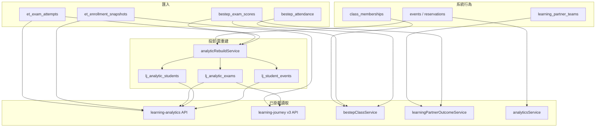

# 02 資料譜系與依賴

信心：下列箭頭以已讀程式為準。未逐行打開的投影細節標 `PARTIAL`。未查資料庫，故「列是否最新」一律 `需資料驗證`。

## 1. 兩類證據

| 類型 | 產生方式 | 時間錨 | 代表表／服務 |
|---|---|---|---|
| 系統行為 | 預約、出席、選課、組隊、問卷作答、週報互動 | 事件發生或紀錄建立 | `events`、`reservations`、班級成員、`learning_partner_*`、問卷表 |
| 外部匯入 | Excel 成績、出席、英檢嘗試、名冊 | 檔案上的學期字串或考試日；另有 `importedAt` | `bestep_exam_scores`、`bestep_attendance`、`et_exam_attempts`、`et_enrollment_snapshots` |

學號是接合鍵。年級有兩套：報名當下 `EnglishTestRegistration.grade`（本次未重讀模型欄位，標註依既有領域說明）與學生主檔／名冊年級。是否每次畫面都分得開：**PARTIAL**。

## 2. Data Lineage Map

`REBUILD` 的輸入清單本次未逐一核對 `analyticRebuildService.js` 全文，上圖「BESTEP 成績與嘗試進入重建」是依模組職責的**部分驗證**。精確欄位對照表：待補讀該服務後才能當契約。

## 3. Analytics Dependency Map（誰讀誰）

| 消費者 | 直接讀 | 不讀 |
|---|---|---|
| `kpiReportService.runKpiReport` | 名冊 `EtEnrollmentSnapshot`（學期＋isActive）＋該生全部 valid `EtExamAttempt` | 不讀快照 `lj_analytic_*`；不依考試日切回名冊學期 |
| `b2ReportService.getSemesterB2Report` | 同一名冊＋`getStudentsBestSkillsMap`（歷史最佳） | 不使用成對分數門檻 200／560 |
| `getLearningAnalyticsOverview` | 快照摘要、LVA、CEFR 分布；若 query 帶 `semester` 才旁路呼叫 B2 報告 | 前端總覽 `OVERVIEW_FILTER_KEYS` 已不含 `semester`，故這條旁路目前 UI 走不到 |
| `bestepClassService` | 班級成員、該學期 BESTEP 出席與成績列的 `passed` | 不走 KPI 政策引擎 |
| `learningPartnerOutcomeService` | 已同意隊伍成員 × 同學期 BESTEP 成績 | 回傳 `definition.caveat` 寫明不保證因果 |
| `analyticsService` | `events.date` CAST 後對 `SEMESTER_RANGES` | 不是英檢母體 |

## 4. Shared Metrics Map

同一中文詞在不同讀取點的定義：

| 詞 | 實作 A | 實作 B | 判定 |
|---|---|---|---|
| B2／達標 | KPI：工具門檻。培力聽讀合計 ≥200、說寫 ≥560（`kpiInstrumentThresholds.js`） | 班級：`bestep_exam_scores.passed`，匯入時四項等級皆 ≥ B2（`isPassed`，且先 `normalizeCefrLevel` 去掉加號） | 業務語意不同，不是同一指標 |
| B2+ | 註解與總覽 `certification.note` 寫「CEFR 達 B2+」；`B2_RANK = 4`，而 `normalizeCefr` 會去掉加號，rank 4 就是 B2 | 快照 `b2plusRate`（`headline`，總覽 UI 已不展示該卡） | 名稱相似。加號在匯入與歷程正規化都已丟，**不能**把 rank≥4 說成簡報上的 B2+ 級距 |
| 接近 B2 | `b1PlusWatch.js`：尚未達 B2 且 GSE 51–58 | 路由仍名 `b1-plus` | 產品刻意用 GSE，不是 CEFR 字串 B1+ |
| 學期通過率 | 名冊 × 歷史最佳技能 | 名冊 × 全部有效嘗試的成對規則 | 技術上兩支服務；語意不可互換 |
| 參與 | 活動分析：預約／名額／簽到落在學期日期區間 | 快照資源：累積曝光時數（總覽註解與資源頁） | 時間刀不同，分母不同 |

## 5. Duplicate Calculation Map

| 重複類型 | 證據 | 是否可當同一數字 |
|---|---|---|
| 技術重複 | 總覽在有 `semester` 時呼叫 `getSemesterB2Report`；學習歷程儀表板另有 `b2-report` | 同一函式則數字應相同；UI 已不再送學期，總覽這條目前閒置 |
| 指標重複（假） | KPI 報表 vs 學期 B2 報告 vs 班級 `passed` | 不可加總或互為交叉檢查，除非先對齊規則 |
| 隱藏轉換 | 培力匯入 `normalizeCefrLevel`：`B2+`→`B2`，`未達A1`→`A1`（測試 `bestepScoreImportFormat.test.js`） | 來源檔加號無法從資料庫還原 |
| 匯入後不同步 | 班級頁讀 `bestep_exam_scores`；分析頁讀快照 | 匯入成功 ≠ 快照已重建。需資料驗證 |
| 權限母體 | 活動分析與報表有班級／教師 scope；學習成效另有工作集 | 同一標題在不同帳號下母體可不同。頁面是否每張圖都標示：PARTIAL |

## 6. 已證實 vs 需資料驗證

已由程式證實：KPI 不依考試日過濾嘗試；B2 報告用歷史最佳且 rank≥4；班級達標讀匯入布林；加號在培力匯入被剝除；資源效果模型有 `causal_effect` 欄且預設 `causalClaimAllowed=false`（`ResourceEffectEstimate.js`）；LVA 測試預期因果宣告為 false。

需資料驗證：快照版本是否落後最新匯入；有多少 KPI 分子來自名冊學期以外的考試日；`causal_claim_allowed=true` 的列是否為零；`englishTestsRouter.js` 是否仍被腳本呼叫（`server.js` 未掛載，腳本呼叫本次未全庫搜完，標 PARTIAL）。
