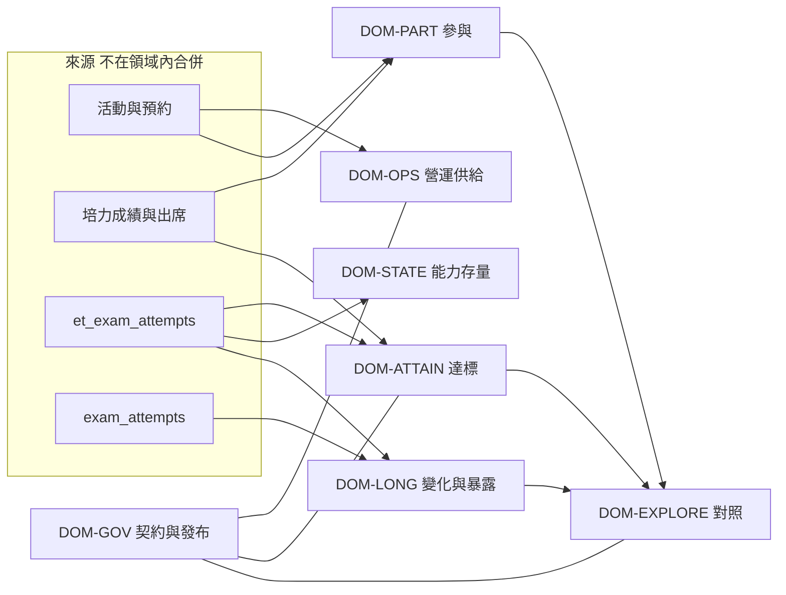

# 01 目標領域模型

候選六領域有調整：把「縱向」拆成**能力存量**與**能力變化**，因為 Phase 2 已證明歷史最佳不是成長。證據治理做成跨域平台，不做成第七個儀表板。資源效果不放進營運域。

## DOM-OPS 營運與名額

| 欄位 | 內容 |
|---|---|
| Purpose | 這一季活動供給是否被預約、簽到、佔用名額 |
| Primary Users | 行政、主任（監測） |
| Business Questions | 有幾場、幾筆預約、簽到列佔預約列多少、名額利用率 |
| Analysis Units | 活動、預約列 |
| Metrics | `ops.event.count`、`ops.reservation.row_count`、`ops.reservation.checkin_row_count`、`ops.reservation.checkin_row_rate`、`ops.capacity.reservation_over_seats` |
| Data Dependencies | `events`、`reservations`。時間用 CAST 後的活動日 |
| Temporal Models | `TC-OPS-DATE-SEMESTER` |
| Supported Comparisons | 兩個日期學期的速率。必須同時看供給量，否則場次變少會像參與下降 |
| Evidence Limitations | 預約 SQL 未排除取消狀態（Phase 2 Q15）。不是學生人數 |
| Ownership | 活動營運。不擁有任何達標定義 |
| Boundaries | 不讀英檢分數。`ops.registration.legacy_has_cefr_b2` 雖由營運 API 算出，領域上改掛 DOM-ATTAIN 的 legacy 槽，預設不進主任監測 |
| Dependencies | 無。日期解析與 DOM-PART 的字串比較不同，禁止互減 |

## DOM-PART 學習參與

| 欄位 | 內容 |
|---|---|
| Purpose | 名單上的人有沒有出現、培力分項或合併碼的出席、近 30 日微學習、有伴流程 |
| Primary Users | 行政、教師、主任（只看彙總） |
| Business Questions | 這份名單多少人至少簽到一次、平均簽到次數、這一檔培力誰到、微學習近期有沒有人用 |
| Analysis Units | 學生（在一份明確名單內）、出席列、軌跡事件 |
| Metrics | `ops.roster.distinct_checkin_students`、`ops.roster.distinct_checkin_rate`、`ops.roster.avg_checkin_count`、`ops.participation.streak`（Proposed）、`bestep.file.attendance_lr_sw_avg`、`trace.micro_learning.30d`。有伴漏斗沿用 S4-A，本階段仍 PARTIALLY_VERIFIED，不新發 Metric ID |
| Data Dependencies | 預約簽到、`bestep_attendance`、`learning_trace_events`、學習有伴隊伍 |
| Temporal Models | `TC-OPS-DATE-STRING`、`TC-BESTEP-FILE-SEMESTER`、`TC-TRACE-ROLLING-30D` |
| Supported Comparisons | 同一名單定義下的兩期參與率。不可與 DOM-OPS 的列出席率比 |
| Evidence Limitations | 行政培力出席只認 LR／SW。微學習不進快照。持續參與尚未實作 |
| Ownership | 學務／活動行政對名單參與；培力行政對出席碼 |
| Boundaries | 出席不是達標。簽到不是學習投入的完全定義 |
| Dependencies | 名單若來自班級或名冊，只借用身分範圍，不借用達標規則 |

### 營運與參與的分界

DOM-OPS 回答「場次與名額這類供給被用掉多少」，單位是列。DOM-PART 回答「這群人有沒有出現」，單位是人。Phase 2 已證明兩者的日期語法都不同（CAST 對字串 BETWEEN）。分界理由是單位與時間契約，不是選單位置。

## DOM-ATTAIN 評量達標

| 欄位 | 內容 |
|---|---|
| Purpose | 在一份寫明的母體、一條寫明的規則、一個寫明的嘗試範圍下，多少人達到該規則 |
| Primary Users | 主任與行政只在 Usage Mode = Official 且 D1 已核准時看「正式成果」。在那之前只看監測用的具名指標 |
| Business Questions | 這一檔四項等級是否都達 B2；名冊上聽讀成對或說寫成對是否過某政策；行政通過率（另分母） |
| Analysis Units | 學生 × 規則。不是「學生的英語能力」這個統稱 |
| Metrics | `bestep.file.skill_score`、`bestep.file.skill_level`、`bestep.file.skill_reached_b2`、`bestep.file.four_skill_cefr_b2`、`ops.roster.bestep_pass_over_attendance`、`roster.pair_pass.listening_reading`、`roster.pair_pass.speaking_writing`、`roster.pair_pass.both_pairs`（Proposed）、`ops.registration.legacy_has_cefr_b2` |
| Data Dependencies | 培力檔讀 `bestep_exam_scores`。成對讀 `et_exam_attempts`。兩者不自動對帳 |
| Temporal Models | `TC-BESTEP-FILE-SEMESTER`、`TC-ROSTER-LIFETIME-DEFAULT`。Official 模式將來改掛 Reporting Period＋As-of，但該掛法本身等 D2／D3 |
| Supported Comparisons | 只有同一 Metric ID、同一政策鍵、同一缺漏政策。禁止四項等級率減成對率 |
| Evidence Limitations | 加號已摺疊。缺等級與未達標在培力布林上相同。成對預設終身窗 |
| Ownership | 評量政策擁有者（中心＋教務規則）。工程只實作已編號的規則，不新造門檻 |
| Boundaries | 不包含歷史最佳，不包含 GSE 成長 |
| Dependencies | 母體可以是 DOM-PART 的班級或名冊服務提供的身分清單，但分母定義寫在指標上 |

### 培力場次與名冊達標

培力場次成果是 `bestep.file.*`：檔案學期、成績表、四項等級。名冊成對是 `roster.pair_pass.*`：名冊身分、et 嘗試、政策鍵。D4 未核准前，架構**同時保留兩條**，不把場次結果寫進名冊 KPI，也不用名冊 KPI 填場次簡報。`roster.pair_pass.both_pairs` 仍是 Proposed，不能拿來補「四項達標」。

## DOM-STATE 能力存量

| 欄位 | 內容 |
|---|---|
| Purpose | 截至某時刻，這個人各技能「目前看到的最好等級」或快照上的等級分布。這是狀態，不是該學期考試成果 |
| Primary Users | 輔導、教師、研究。主任監測只在文案寫明「截至今日」時可看 |
| Business Questions | 誰的歷史最佳已達 B2 基底等級、誰落在 GSE 51–58、快照裡等級怎麼分布 |
| Analysis Units | 學生 × 技能，或快照列 |
| Metrics | `roster.best_skill_state`、`roster.best_skill_rank_b2`、`snapshot.exam_cell_rank_b2`、`snapshot.near_b2_gse`、`etgroup.gse_snapshot` |
| Data Dependencies | 歷史最佳只讀 et。快照格子來自分投影。分組 GSE 是指派當下的複本 |
| Temporal Models | `TC-ROSTER-BEST-ASOF-NOW`、`TC-SNAPSHOT-VERSION` |
| Supported Comparisons | 同一 as-of 或同一 snapshot version 內的群體切片。禁止把兩年的歷史最佳率當趨勢，除非未來有凍結 as-of（D3／D9，未核准） |
| Evidence Limitations | 會被晚到成績改寫。rank≥4 不是 B2+。技能可來自不同工具 |
| Ownership | 學習歷程讀模型的維護者擁有計算；對外稱呼由 DOM-GOV 限制 |
| Boundaries | 不得進 Official Attainment 槽 |
| Dependencies | 與 DOM-ATTAIN 共用 et 表，不共用規則 |

歷史最佳放在這裡，不放在達標域，也不放在變化域。Phase 2：它沒有截止日、不要求同一場考試、不是前後梯差。

## DOM-LONG 變化與考前暴露

| 欄位 | 內容 |
|---|---|
| Purpose | 同一人、同一工具、相鄰梯次的差異，以及該次考試前窗的時數 |
| Primary Users | 分析人員。主任不把這域的平均當正式成果 |
| Business Questions | 有兩梯的人原始分或 GSE 差多少、考前窗有多少時數、有多少成長段 |
| Analysis Units | 學生 × 工具 × 技能 × 梯次對 |
| Metrics | `snapshot.gse_raw_delta`、`snapshot.gse_adjusted_delta`、`snapshot.skill_exposure`、`snapshot.growth_episode` |
| Data Dependencies | `lj_analytic_exams` 及其投影來源。學測不進分析考試列 |
| Temporal Models | `TC-EXAM-SESSION`、`TC-EXPOSURE-BEFORE-EXAM`，外加快照版本 |
| Supported Comparisons | 同工具相鄰梯。GSE 跨工具只可當比較尺，不可當達標，也不可把原始分跨工具相減 |
| Evidence Limitations | 沒有第二梯的人被排除。校正後成長是統計調整 |
| Ownership | 分析工程擁有窗與對照表版本（GSE `2026-v1`） |
| Boundaries | 調整後的數字的**解讀**在 DOM-EXPLORE，計算可以留在本域 |
| Dependencies | 依賴快照投影，因此有來源延遲。不依賴 DOM-ATTAIN 的政策 |

## DOM-EXPLORE 對照與探索

| 欄位 | 內容 |
|---|---|
| Purpose | 在寫明樣本與限制下，描述群體差異或同時出現的現象 |
| Primary Users | 分析人員。主任僅在限制句可見時看摘要 |
| Business Questions | 有伴與非有伴的分數差、資源估計的描述值、系所切片 |
| Analysis Units | 對照群、模型執行 |
| Metrics | `partner.score_gap`、`snapshot.resource_effect`。系所比較沿用快照描述，不新造達標 ID |
| Data Dependencies | 有伴用培力成績表。資源效果用快照與模型表 |
| Temporal Models | 檔案學期或快照版本，另加對照窗 |
| Supported Comparisons | 只在同一規則的兩群。預設宣稱天花板是 Associational 或 Adjusted，不是 Causal |
| Evidence Limitations | 有伴 API 已有 caveat。`causalClaimAllowed` 預設 false |
| Ownership | 研究分析。不可把結果回寫成 DOM-ATTAIN 的正式率 |
| Boundaries | Resource Effectiveness 放本域，不放 DOM-OPS。它不回答名額利用率 |
| Dependencies | 讀 DOM-PART／ATTAIN／LONG 的輸出時必須沿用原 Metric ID，不得改名 |

## DOM-GOV 證據與發布（跨域）

| 欄位 | 內容 |
|---|---|
| Purpose | 保存契約、母體句、缺漏政策、宣稱等級、發布凍結。不產生第二套達標數字 |
| Primary Users | 分析工程、發布核准人、稽核 |
| Business Questions | 這個數字是哪一條規則、截至何時、能不能重算、允許說到哪一級 |
| Analysis Units | Metric Result、Report Run |
| Metrics | `snapshot.evidence_quality` 只是快照內的一條品質帶，不是本域的全部。本域擁有的是跨域標籤，不是另一個率 |
| Data Dependencies | 政策表、將來的發布儲存、現有規則版本字串 |
| Temporal Models | As-of、Generated At、Data As Of、Published At 分開 |
| Supported Comparisons | 只比較同一 Metric Version 的兩次 Run 是否在容忍差內 |
| Evidence Limitations | 舊資料常常不可重算 |
| Ownership | 平台。業務規則的核准人不是工程 |
| Boundaries | 不決定 D1 的選項 |
| Dependencies | 被所有領域呼叫 |

## Learning Journey 與正式成果如何共用資料

共用的是**來源身分與學號**，以及未來的 Assessment Read Model（`04`，不自動合併）。不共用「快照上的 isB2plus」當作正式達標。正式成果若核准某條成對規則，應直接讀 et 嘗試與政策，與今天 KPI 相同的表；快照繼續服務 DOM-STATE 的分布與 DOM-LONG 的梯次。重建快照失敗不得讓班級培力頁或已發布的 Frozen Result 改變。

## Evidence Quality 如何跨域

不把 `snapshot.evidence_quality` 提升成全系統分數。各域結果都附 DOM-GOV 的標籤（見 `07`）：覆蓋、缺漏政策、時間資格、來源新鮮度、規則版本、宣稱上限。快照品質帶只在 DOM-LONG／DOM-STATE 的快照指標上出現，並註明它不是培力檔或活動列的品質。
