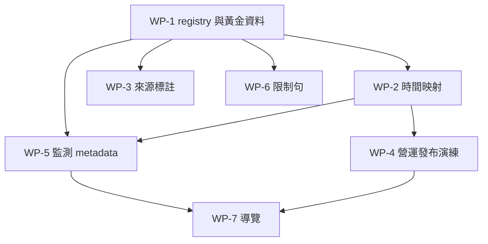

# 11 實作路線

本檔仍是 PROPOSED 的工作順序，不是開工許可。每個工作包都可以單獨合併、單獨關掉。禁止一次重寫所有分析頁。

順序理由：先有契約測試才知道並行比對在比什麼（WP-1）。時間信封與來源標註不改數字（WP-2、WP-3）。發布表先用營運指標演練，避免在達標政策未決時凍結錯的率（WP-4）。最後才動導覽（WP-7）。中間的 WP-5、WP-6 是舊頁加標籤，不切換計算。

若 D1 在 WP-4 之前核准，仍然不要跳過 WP-1 的黃金資料。核准只打開 Official 槽的白名單，不縮短驗證。

## WP-1 契約 registry 與黃金資料

```text
Work Package ID: WP-1
Goal: 把 32 個 ID、9 個時間契約、宣稱天花板放進可測試的 registry。不改任何現有計算結果。
Dependencies: 無
Affected Domains: DOM-GOV
Affected Metrics: 全部 32。streak 與 both_pairs 只有定義、沒有 executor。
Decision Gates: 無。不得在此包改 D2 或 D6。
Data Migration Required: 否
Implementation Scope: 後端模組與測試。無新路由、無畫面。
Acceptance Criteria: 契約測試列出每個 ID 的領域、契約、天花板、officialEligible=false。黃金資料 10 情境在現有服務上的斷言與 Phase 2 行為一致，包含雙軌數字可以不同、B2+ 存成 B2。
Test Strategy: Jest。合成學號。不連正式庫。
Rollback Strategy: 刪除新模組。無資料變更。
Risk: 測試寫成「兩軌必須相等」會逼人改公式。驗收禁止這種斷言。
```

## WP-2 Query Context 映射

```text
Work Package ID: WP-2
Goal: 舊 API 的學期參數對應到該 ID 的具名 bound，並在內部拒絕跨契約比較。對外回應仍可暫不改，先在測試裡證明映射。
Dependencies: WP-1
Affected Domains: OPS、PART、ATTAIN
Affected Metrics: 營運、參與、培力檔、成對
Decision Gates: 指定 as-of 回 not_supported，不等 D9 做完才交包。
Data Migration Required: 否
Implementation Scope: 對照表與拒絕規則。不改 SQL 的 WHERE。
Acceptance Criteria: 同一字串 114-2 映射成 event range、file semester、roster semester 三個不同 bound。把它們丟進一個比較函式會失敗。
Test Strategy: 單元測試映射表。
Rollback Strategy: 不呼叫新比較函式。
Risk: 過早改前端下拉。此包明確不含前端。
```

## WP-3 來源標註

```text
Work Package ID: WP-3
Goal: Assessment Observation DTO 帶 source identity。偵測 possibleSameSitting 只產出計數或測試雙路徑，不寫回、不合併。
Dependencies: WP-1
Affected Domains: ATTAIN、STATE、GOV
Affected Metrics: bestep.file.*、roster.pair_pass.*、roster.best_skill_*
Decision Gates: D11 擋住合併與 prefer et 的變更。本包不碰投影。
Data Migration Required: 否
Implementation Scope: 讀取 DTO 與測試。舊服務繼續被舊路由使用。
Acceptance Criteria: 只有培力表的人不會出現在成對 DTO。候選鍵缺日期時不產生。CEFR 相同不會被標成同一筆。
Test Strategy: 黃金資料第 4、8 點。
Rollback Strategy: 不使用 DTO。
Risk: 有人把 DTO 接上 KPI 並「順便」改時間窗。程式審查要拒絕與本包無關的 WHERE 變更。
```

## WP-4 發布表演練（僅營運指標）

```text
Work Package ID: WP-4
Goal: Frozen Result 可建立、不可覆蓋、可標 superseded。白名單只有五個 OPS 指標。
Dependencies: WP-1。WP-2 的映射若未完成，發布請求仍須自帶 event range，不能只送學期字串。
Affected Domains: OPS、GOV
Affected Metrics: ops.event.count、row_count、checkin_row_count、checkin_row_rate、capacity
Decision Gates: D1 未過，達標 ID 送審必須 409。D3 未過，不承諾 Reproducible，manifest 標 Frozen+Traceable。
Data Migration Required: 是，新增發布儲存的 migration。這是未來的實作項，本階段不寫 migration 檔。
Implementation Scope: 一張發布表或等價 JSON 儲存、狀態機、權限沿用管理端。不含主任新首頁。
Acceptance Criteria: 發布後再插入一筆預約，published 的 row_count 不變。達標 ID 不能 in_review。同日第二次發布是新 Run，不是 UPDATE。
Test Strategy: 服務測試用交易回滾或 sqlite／測試庫，不碰正式庫。
Rollback Strategy: 停止寫入。已寫列只讀保留。業務表無變更。
Risk: 營運附錄被對外稱作英語成果。文件與 API 的 reportKind 必須是 operational_appendix。
```

## WP-5 監測回應附 metadata

```text
Work Package ID: WP-5
Goal: 現有 KPI、班級 BESTEP、預約總覽的 JSON 增加 metric 區塊，不刪舊欄位。數字與 WP-1 基線相同。
Dependencies: WP-1、WP-2
Affected Domains: OPS、PART、ATTAIN、STATE
Affected Metrics: 上述頁面已顯示的 ID
Decision Gates: official 恆 false。lifetime 限制句必須出現在成對結果。
Data Migration Required: 否
Implementation Scope: 回應組裝。前端可暫不讀新欄位。
Acceptance Criteria: 並行比對舊欄位差異為 0。新欄位含 metricId、temporalContract、limitations。
Test Strategy: 既有 API 測試加欄位斷言。
Rollback Strategy: 功能旗標拿掉組裝。
Risk: 舊客戶端若嚴格拒絕未知欄位。先確認前端與測試是寬鬆解析；若有嚴格客戶端，此包暫停。
```

## WP-6 限制句不丟失

```text
Work Package ID: WP-6
Goal: 有伴 caveat、課師「非因果」、資源頁不做排名、歷史最佳不再被 overview note 稱為 B2+ 認證率，這些句子與新天花板一致。只改會誤導的 note，不改數字。
Dependencies: WP-1
Affected Domains: EXPLORE、STATE
Affected Metrics: partner.score_gap、snapshot.resource_effect、snapshot.gse_adjusted_delta、roster.best_skill_rank_b2
Decision Gates: D8、D9 不在此包實作成 as-of。
Data Migration Required: 否
Implementation Scope: 後端 note 與既有前端已有的限制句盤點。改字屬於實作，要另開核准；本路線只定義允許改的句子範圍。
Acceptance Criteria: 契約測試鎖定限制句關鍵字仍在。overview 在不送學期時行為不變。
Test Strategy: 字串與 API note 測試。
Rollback Strategy: 還原字串。
Risk: 使用者以為 B2 定義變了。變更說明要寫「名稱改成與 rank≥4 一致」，數字定義未變。
```

## WP-7 工作流導覽

```text
Work Package ID: WP-7
Goal: 主任監測、培力草稿、名冊草稿、發布、研究頁的入口按 06 的責任分開。舊 URL 保留並導到原頁，直到該頁已掛 metadata。
Dependencies: WP-5 至少覆蓋要搬的頁。WP-4 若未做，發布入口不出現。
Affected Domains: 全部使用者可見領域
Affected Metrics: 不改
Decision Gates: D7 未決時，主任頁只放 OPS 五 ID，達標區顯示未發布。這是安全預設，不是替主任做完 D7。
Data Migration Required: 否
Implementation Scope: 導覽與頁面搬移。不合併班級與 KPI。
Acceptance Criteria: 主任頁沒有成對率、沒有歷史最佳、沒有校正成長。教師仍進得了班級。研究頁進不了發布。
Test Strategy: 路由與權限測試。瀏覽器走一遍五個工作流的入口，不要求新視覺。
Rollback Strategy: 還原導覽設定。
Risk: 把舊學習成效選單拆壞，書籤失效。舊路徑要留重導一個學期。
```

## 明確不做的包

- 不實作 streak 與 both_pairs。
- 不把 B2 還原成 B2+。
- 不把 bestep 列複製進 et。
- 不把快照 sequence 改成正式報告。
- 不在 D2 核准前修改 `loadAttemptsForStudents` 的終身行為。
- 不重寫問卷、週報、口說。它們留在 Unverified 清單，另案若要納入再發 Metric ID。

## 依賴圖



WP-3 與 WP-6 可與 WP-2 並行。WP-4 與 WP-5 可並行。WP-7 最後。
