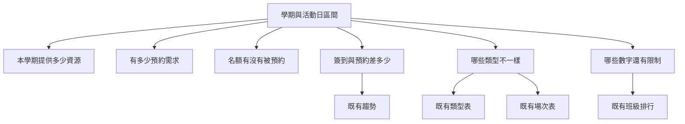

# 兩種營運分析資訊架構

現有 `AdminAnalyticsPage` 已經把這頁限定成活動營運，並寫明不解讀 B2。第一屏仍是四張短標題卡片，接著是類型表、場次表、趨勢與班級排行。API 沒有活動類型篩選；學期是唯一的查詢條件。名額分項主要來自另一支既有 API，與總覽嵌套的 `capacityBreakdown` 使用同一組服務。

下面兩種方案都不新增 API，也不刪現有區塊。

## Option A — 以決策問題當入口

主任打開頁面，先看到六個問題，而不是先看到四個比率。

| 區塊 | 回答的問題 | 使用的既有數字 | 必須同時看見的限制 |
|---|---|---|---|
| 資源供給 | 提供多少場次與名額 | 名額加總；分項裡的場次數要等 L3 或由現有場次表列數呈現 | 含隱藏場次與零預約場次。待 L3 標註 |
| 預約需求 | 有多少預約 | 預約筆數 | 是筆數，不是學生人數。待 L3 才知道差多少 |
| 供需 | 名額是否被預約 | 預約名額比 | 分母含沒人預約的場次 |
| 實際參與 | 預約之後有沒有到 | 預約列簽到率 | 分母含未簽到與違規狀態 |
| 類型差異 | 哪種類型不同 | 既有類型表 | 與總計同一日期窗；不要把類型表再加一次 |
| 例外與限制 | 哪裡不能直接下結論 | 預約列違規狀態比、日期窗、隱藏場次說明 | 違規表尚未對帳。待 L3 |

篩選仍只有學期。類型表可以在瀏覽器裡收合，不改變頭條數字。缺資料時沿用現有的零值與「日期無法解析」提示。下一步是展開類型、展開場次、或看班級排行。不從這頁跳到學習成效，除非使用者自己去既有的成效分析入口。

## Option B — 沿行政流程排

依主任與行政實際處理場次的順序：供給、預約、到場、例外、報表。

這比較接近現在頁面由上到下的工作順序，行政人員找某一場的名額時路徑短。主任若只想知道「資源夠不夠、人有沒有來」，要自己把四張卡片翻譯成問題。違規率仍容易被看成全部違規事件。

## 比較

| 項目 | Option A | Option B |
|---|---|---|
| 主任閱讀 | 問題對應決策，第一屏較短 | 要先懂每個比率的母體 |
| 行政操作 | 場次明細在第二層，多一次展開 | 場次表靠近流程，較直接 |
| 語意 | 供給、需求、到場、例外分開 | 沿用現在的營運順序，短標題仍易混 |
| 既有功能 | 卡片、類型表、場次表、趨勢、班級排行都留著 | 同樣全留 |
| 導航 | 第一屏問題，第二屏明細 | 一頁直排，與現況接近 |
| 以後擴充 | 新問題可以加一列，不必新 API | 新數字容易再塞進同一排 KPI |
| 實作成本 | 改區塊標題與說明，稍高 | 主要改文案，較低 |

## 建議

採用 A 當第一屏、B 的明細順序當第二屏。也就是混合，但入口以主任的問題為準。理由：這頁的使用說明已經聲明它不是學習成效；還沒做完的是讓供給、需求、到場和例外在數字旁邊就分得開。行政要查某一場時，現有場次表保留在問題下方，不另做一個工作台。

`englishPassRate` 不進入任一屏的核心 KPI。API 仍回這個欄位。若將來要給人看，只放在摺疊的「非本頁母體」裡，標題使用「報名資料 B2 標記比例」，並寫明不是活動後的英語能力。在 L3 完成前，供給是否含隱藏場次、違規狀態與違規表是否一致，都標成待驗證，不寫成已核定成果。
