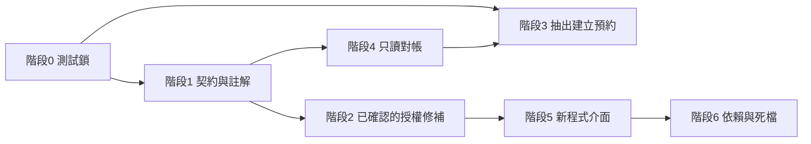

# EEARS 收斂路線（CONSOLIDATION_ROADMAP）

- 稽核日期：2026-10-29
- 原則：不重寫、不合併資料表、不先刪檔。每一階都要能單獨上線與回滾。
- 編號對應 `TECHNICAL_DEBT_REGISTER.md`。

## 不要做的事

- 不要把 `Users`、`students`、`et_student_master`、報名、班級合成一張學生表。
- 不要把 `et_exam_attempts` 停寫或關掉 v3 fallback，除非該學期對帳已通過。
- 不要把問卷改成只寫 `survey_responses`，除非 legacy 報表的讀取點已列出。
- 不要用一個 DataTable、一個匯入器、一個錯誤格式一次替換全部路由。
- 不要因為檔案沒被 `App.js` import 就刪頁面或 router。
- 不要把 PM2 調成多 instance 來「順便」解決效能。排程還在 API 進程裡（AUD-BE-05）。
- 不要為了文件過期去改現況 API。

## 階段 0 — 鎖住底線（只加測試與對帳，不改行為）

目的：讓後面的搬移有失敗信號。

| 項目 | 內容 | 對應 |
|------|------|------|
| 0.1 | 用 mock，測 `checkSurvey` 未完成時 409 且 `redirectUrl` 以 `/survey/` 開頭 | AUD-BE-03 |
| 0.2 | 測預約建立會拒絕與 session 不符的學號（`bindStudentIdentity`） | AUD-SEC-04 |
| 0.3 | 測黑名單期間不可預約（沿用 `blacklistEnforcementService` 現有測試，缺則補一條） | AUD-DA-06 |
| 0.4 | 枚舉 `App.js` `/admin` 路由，每一條都要能在 `adminRouteAccess.js` 找到規則或標成 redirect | AUD-FE-01 |
| 0.5 | 權限鍵：後端 `P` 與前端 `constants/permissions.js` 集合相等 | AUD-FE-07 |
| 0.6 | 掃描 `/api/admin` 路由檔必須含 `authMiddleware`，例外寫進 allowlist 檔並附理由 | AUD-SEC-01 |

驗收：上述測試在 CI 會紅會綠，且目前主幹是綠的。若 0.4 或 0.6 一開始就紅，先把差異列成清單，不要為了變綠而放寬檢查或改產品行為。

回滾：只刪測試。無資料遷移。

## 階段 1 — 把「現況契約」寫下來（仍不改行為）

| 項目 | 內容 |
|------|------|
| 1.1 | 錯誤形狀清單：Gate 409、權限 403、stale 401、預約 400 各留一條範例 JSON。新端點只能加欄位 | AUD-BE-01、AUD-SEC-05 |
| 1.2 | 個人資料認證決策表：必須 student JWT／允許 email OTP／允許公開。護照與學習有伴先標成「維持現況，待產品確認」 | AUD-FE-02、AUD-SEC-04 |
| 1.3 | 讀 `myStatus` 的回傳欄位。若含答案或 email，才排進階段 2 的修補；若只有布林，降為 P2 | AUD-SEC-03 |
| 1.4 | 改寫 `server.js` 145–149 行註解，分開「未掛載的 legacy 檔」與「仍掛載的 learningJourneyRouter」 | AUD-BE-04 |
| 1.5 | 權限舊文件首段改指向 `auth/permissions.js` | AUD-SEC-06 |
| 1.6 | 部署Checklist 寫明 PM2 必須維持 1 instance，直到排程拆出 | AUD-BE-05 |

驗收：新文件與程式註解一致；沒有路由或狀態碼變化。

回滾：還原文件。

## 階段 2 — 小範圍授權修補（需產品確認後才改）

只做決策已經清楚的項目。

| 項目 | 做法 | 回滾 |
|------|------|------|
| 2.1 | `GET /teachers/students/participation` 加上既有班級權限，並用教師 id 而不是姓名比對。先在測試環境確認現有教師角色有該鍵 | 還原 middleware。AUD-SEC-02 |
| 2.2 | 若 1.3 確認 my-status 含個人內容：改為 student JWT 或改成不含內容的布林，並保留 Gate 前端所需欄位 | 功能旗標或還原路由。AUD-SEC-03 |
| 2.3 | 問卷雙寫第二步失敗寫入既有 job／audit，而不是只 `console.error`。仍雙寫 | 還原 catch。AUD-DA-05 |
| 2.4 | 清點 `/uploads` 子目錄。公開圖與證件分開的做法另案，本階段只出清單 | 無行為變更則無回滾。AUD-SEC-07 |

驗收：2.1 的無權限 staff 得 403、有權限教師仍看得到自己的班。2.2 若執行，未填問卷的預約仍得到原本的 `redirectUrl`。

不做：不把護照改成強制學生登入（覆蓋率未知）。

## 階段 3 — 抽出「建立預約」服務（第一個行為等價搬移）

範圍只限 `POST /reservations` 的規則與 transaction。

1. 階段 0 的測試先在。
2. 把 route 內的交易區塊移到 `reservationService`，route 只解析 HTTP。
3. 狀態碼、`errorCode`、`redirectUrl`、黑名單與 Gate 順序保持不變。
4. 取消驗證碼邏輯先留在原處（AUD-BE-09 不跟這次一起改）。

驗收：既有預約測試加上一條「成功建立」的 mock 測試。手動煙測：未填問卷、黑名單、截止後、成功預約。

回滾：route 改回呼叫原 inline 函式。不改 schema。

之後才考慮活動 router 與培力報名 router，每次一個用況。培力報名 3624 行不要整檔搬移。

## 階段 4 — 讀取層，而不是合併表

| 項目 | 做法 |
|------|------|
| 4.1 | 學號解析函式：給定學號，回傳各表是否有列、長度是否超過 20。只讀 | AUD-DA-01、AUD-DA-02 |
| 4.2 | 學期對外只用 code 字串；INT id 留在問卷內部 | AUD-DA-03 |
| 4.3 | 用既有 `lj:reconcile-semester`／對帳腳本，按學期比較 `bestep_exam_scores`、`exam_attempts`、`et_exam_attempts` 的筆數 | AUD-DA-04 |
| 4.4 | 孤兒代碼報告：活動的 `eventType`、`semesterId` 對不到主檔的列 | AUD-DA-07 |

驗收：報告可重複執行且不寫入。發現落差後才開獨立的資料修復，不在本路線裡自動修。

回滾：停用報表腳本。

Schema 變更（加寬 `student_id`、補 FK）每項單獨 migration，且 `down` 要能還原。有髒資料時 migration 應失敗而不是靜默刪列。

## 階段 5 — 介面收斂（只在已經造成 bug 或新程式時）

| 項目 | 做法 |
|------|------|
| 5.1 | 新 API 的錯誤使用 `{ success, code, message, requestId }`，並保留舊欄位別名直到前端改完 | AUD-BE-01 |
| 5.2 | 新列表用 `page` + `pageSize` | AUD-BE-08 |
| 5.3 | 新的匯出呼叫統一 `(blob, filename)`，舊呼叫點有測試才改 | AUD-FE-05 |
| 5.4 | 直接 `fetch` 的後台頁，在下一次改那一頁時改為 `fetchClient` | AUD-FE-03 |
| 5.5 | 側欄把成效分析與舊營運報表標成不同產品 | AUD-FE-04 |
| 5.6 | 公開導覽用詞收成「培力英檢」 | AUD-FE-06 |

驗收：舊客戶端仍能讀舊欄位。側欄文案變更要給辦事人員看過。

## 階段 6 — 依賴與死檔（最後，且每項一個 PR）

前提：全庫搜尋 require／import，不只看 `App.js`。

| 項目 | 條件 |
|------|------|
| 移除 `zod`、`bcrypt` | 搜尋為零且登入測試通過。AUD-BE-06、AUD-BE-10 |
| 移除 `axios` 與 `axiosClient.js` | 建置通過。AUD-FE-08 |
| 未掛載 router | 確認沒有動態 require 與外部文件連結後，移到 `legacy/` 或加檔首註解。先不要刪。AUD-BE-04、AUD-FE-09 |
| 不移除 `xlsx` 或 `exceljs` | 兩者都有正式呼叫 |

## 建議順序

階段 2 與階段 4 可以並行。階段 3 必須等階段 0。階段 6 放最後。

## 安全遷移邊界

| 邊界 | 可以獨立發布 | 不可以一起做 |
|------|----------------|----------------|
| 測試與文件 | 是 | 不混進行為修改 |
| 單一路由補權限 | 是 | 不順便重構該 controller |
| 建立預約搬移 | 是 | 不改取消、不改 Gate 條件 |
| 對帳報表 | 是 | 不自動寫回 |
| 加寬學號欄位 | 單獨 migration | 不合併學生表 |
| 停用 legacy 成績寫入 | 單獨學期旗標 | 不刪 `et_*` 表 |

## 整體驗收（全部階段都完成時才適用）

- 預約：未登入 401、學號被綁定、未填問卷 409 且 `redirectUrl` 仍在、黑名單被拒、截止後被拒、取消仍要驗證碼。
- 權限：前後端鍵集合一致；抽樣的後台路由無 token 為 401、缺權限為 403。
- 資料：對帳報表可解釋 BESTEP、canonical、legacy 的筆數差；沒有未公告的表合併。
- 前端：管理端新路由缺 access 規則時 CI 失敗。
- 部署：仍為單進程排程，或排程已拆出且有 job 鎖。

## 仍須另案查證後才能排期

- `GET /api/surveys/my-status` 的實際 JSON
- `getStudentParticipation` 的回傳欄位
- `/uploads` 是否含證件或名冊
- 口說與 learning-traces 是否寫入可識別學號
- `learningJourneyRouter` 的呼叫端清單
- 正式庫學號最大長度與孤兒 `eventType`
- 黑名單週日解封的時區案例
- 候補模型是否仍有寫入
- 全庫循環依賴
- 瀏覽器上的版面、空狀態與手機月曆

這些在查完之前，不進入實作。
