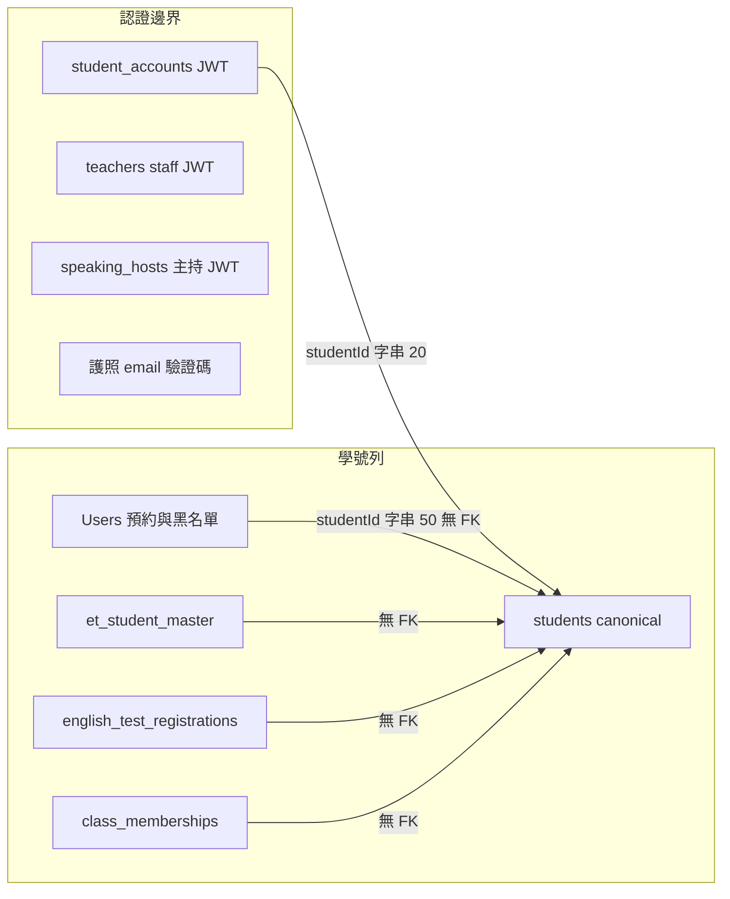
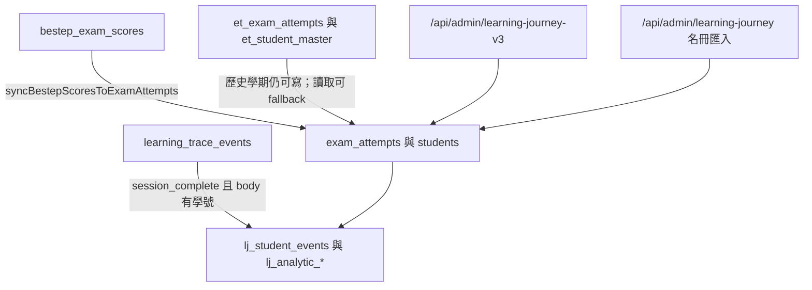

# 領域邊界圖（DOMAIN_BOUNDARY_MAP）

- 日期：2026-10-29
- 圖中的箭頭是現行程式路徑，不是目標架構。
- 擁有者是「這個寫入的權威」。讀取可以跨邊界，寫入不應再發明第四個學號主檔。

## 學生身份

| 實體 | 表 | 擁有者模組 | 鍵 | 誰可以寫 | 失敗時怎麼回復 |
|------|----|------------|----|----------|----------------|
| 登入帳號 | `student_accounts` | 學生認證 | 學號 STRING(20)，email 另有唯一 | `studentAuthService` | 帳號審核表 `student_account_reviews`。沒有帳號的人仍可用護照 OTP 或舊表單 |
| 預約的人 | `Users` | 預約／黑名單 | INT `id` + 學號 STRING(50) | 預約與違規流程 | 黑名單狀態在這列。預約列本身只存學號字串，不 FK |
| Canonical 學生 | `students` | Learning Journey | BIGINT `id` + 學號 STRING(20) | 匯入與 sync | `studentPk` 只出現在 `exam_attempts` 這類 canonical 子表 |
| Legacy 名冊 | `et_student_master` | 舊英檢 | 學號 STRING(50) | 舊匯入 | 讀模型 fallback。不是登入來源 |
| 培力報名 | `english_test_registrations` | 培力報名 | `(studentId, semester)` | `englishTestRegistrationRouter` | 與 `students` 無 FK。姓名以報名列為準 |
| 班級成員 | `class_memberships` | 班級 | 學號 STRING(50) + `classId` | 名冊匯入 | 教師姓名在 `classes.teacherName`，參與端點用名字對，不用教師 id |

回復策略今天沒有一個「重算所有表」的交易。各 sync（BESTEP → attempts、問卷雙寫、權限雙寫）失敗時的行為不同：問卷新表失敗只記 log；BESTEP sync 是明確的工作；權限有 `accessVersion` 讓舊 token 失效。

## 學期

| 表示 | 擁有者 | 對外代碼 | 轉換點 |
|------|--------|----------|--------|
| `semesters.id` INT + `code` | 問卷與部分活動 | `code` 如 `114-1` | `SurveyRule.semesterId`、`Event.semesterId` |
| `et_semesters.id` STRING | Legacy ET | 主鍵就是代碼 | 名冊、ET 匯入、`snapshotDate` |
| 各表字串欄 | 報名、班級、BESTEP、`StudentSemesterProfile` | 同一個代碼 | 沒有 FK |
| `utils/semesterConstants` 的日期區間 | 前後端設定 | 代碼 → 起迄日 | `buildSemesterEventFilter` 的第三個來源 |

缺陷會出現在轉換點，而不是出現在「有一個字串欄」本身。`buildSemesterEventFilter` 用 OR 接上三種日期。若靜態區間與 `semesters.startDate` 不一致，活動會被多算進來。空代碼則不加條件，等於不依學期過濾。

## 學習歷程、ET、BESTEP

| 儲存 | 角色 | 觸發 | 對帳 |
|------|------|------|------|
| `bestep_exam_scores` | BESTEP 原始成績 | 班級／BESTEP 匯入 | 源頭 |
| `exam_attempts` | canonical 成績，含 `sourceType` | sync、匯入 | `studentPk` + `dedupeKey` |
| `et_exam_attempts` | legacy | 舊匯入；門檻學期之後政策改為不寫 | `reconciliationService`、每日 governance 腳本 |
| `lj_*` | 投影 | rebuild、軌跡投影 | 可重建。不是現場交易的來源 |
| `learning_trace_events` | 微學習事件 | 瀏覽器匿名 POST | 見 XL-02 |

消費者（卸除舊路由前必須還在）：

- 後台學習歷程頁：`learningJourneyV3Api.js`
- 課程名冊：`learningJourneyApi.js` 的 `postAcademicCourseRosterDryRun`／`Apply`，由已掛路由的 `LearningJourneyV3ImportSection.jsx` 呼叫
- 未掛路由但仍引用舊 API 的檔：`LearningJourneyHubPage.jsx`、`LearningJourneyStudentPage.jsx`、`useLearningJourneyHub.js`。不能因為沒在 `App.js` 就當沒人要

## 工作流程對照

### 預約一場活動

| 層 | 位置 |
|----|------|
| 畫面 | `EventsPage`、`useEventBooking`。我的預約有 `RequireStudentAuth` |
| API | `POST /api/reservations`：學生 JWT、覆寫學號、`checkSurvey`、交易在路由內 |
| 服務 | 建立邏輯主要在路由；取消在 `reservationService` |
| 資料 | `reservations` 字串學號；黑名單看 `Users`；Gate 看 `survey_rules` 與 legacy 作答 |
| 失敗 | 409 加 `redirectUrl`；黑名單與截止是別的狀態碼與 `errorCode` |

### 填問卷以通過 Gate

| 層 | 位置 |
|----|------|
| 畫面 | `SurveyPage` 呼叫 `checkSurveyFilled` |
| API | `GET /api/surveys/check/:surveyId/:studentId` 只回是否已填。提交走公開 POST |
| 服務 | `submitPublicResponse` 先寫英桌或英社表，再寫 `survey_responses` |
| 資料 | 兩張作答表。Gate 讀規則表 |
| 失敗 | 新表寫入失敗不回滾舊表（只記 log） |

### BESTEP 成績進到分析

| 層 | 位置 |
|----|------|
| 畫面 | 班級 BESTEP、匯入中心卡片（導覽） |
| API | `bestepRouter`、班級匯入 |
| 服務 | 匯入寫 `bestep_exam_scores`；另一次 sync 寫 `exam_attempts` |
| 資料 | 原始表保留。分析讀 canonical 或投影 |
| 失敗 | sync 應可重跑。本次未驗證正式作業的冪等結果 |

### 微學習

| 層 | 位置 |
|----|------|
| 畫面 | `/practice/*`，不需登入。自願學號在 sessionStorage |
| API | `POST /api/learning-traces` 無 JWT |
| 服務 | 寫軌跡；完成事件且有學號則投影到 `lj_student_events` |
| 資料 | 軌跡表可匿名。投影表會把該學號算進學習歷程 |

### 護照送件

| 層 | 位置 |
|----|------|
| 畫面 | `/student/english-learning-passport`，沒有 `RequireStudentAuth` |
| API | email 驗證碼、captcha、rate limit |
| 資料 | `english_learning_passports` 與提交表，學號 STRING(50)，不 FK 到 `students` |
| 管理端 | `adminEnglishLearningPassportRouter` 整檔 `authMiddleware` |

## 前端邊界

| 邊界 | 共用 | 應保持領域差異 |
|------|------|----------------|
| 殼層 | `PublicLayout`、`AdminLayout`、`design-system.css`、`ToastProvider`、`ConfirmDialog`、`RouteLoading` | 公開頁與後台密度不同 |
| 空狀態 | `components/ui/EmptyState.js` | 學習歷程 hub 另有空狀態，因為欄位語意不同。新頁面再用共用件即可 |
| 學期選擇 | `semesterUtils`、`semesterConfig` | 匯入畫面自己組 option，是因為匯入要綁該匯入器的學期代碼，不是因為缺一個下拉元件就必須抽象 |
| 匯出 | 各 service 的 `downloadBlob` | 參數順序不一致是維護風險（P3），不是錯誤的業務規則 |
| HTTP | `fetchClient` | `axiosClient` 無引用。違規頁等仍直接 `fetch`，401 過期處理會漏 |
| 導覽 | `adminNavigation.js`、`adminRouteAccess.js`、`App.js` | 三份都要在，直到有自動對照。不要生成式改寫當第一個 PR |
