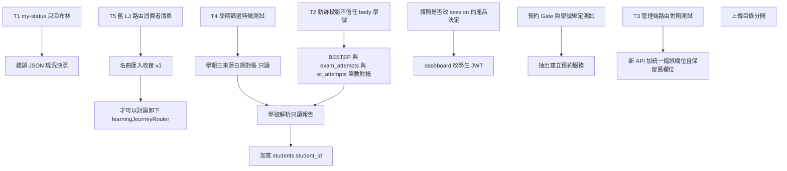

# 重構依賴圖（REFACTORING_DEPENDENCY_GRAPH）

- 日期：2026-10-29
- 箭頭表示「必須先完成」。沒有箭頭的項目不能平行硬做。
- 節點是工作包，不是檔案刪除。

## 依賴說明

| 後做的事 | 為什麼要等 |
|----------|------------|
| 卸下 `learningJourneyRouter` | T5 證明名冊匯入仍呼叫它。要先改 `LearningJourneyV3ImportSection` 的 import，並再搜尋一次外部客戶端 |
| 加寬或合併學號欄位 | 先知道正式庫最大長度與哪些表會截斷。合併表不在這張圖的末端以前出現 |
| 停寫 `et_exam_attempts` | 筆數對帳與歷史學期政策（INV-11）通過 |
| 問卷只寫 `survey_responses` | 列出仍讀 legacy 表的匯出與 Gate |
| dashboard 改 JWT | 產品確認使用者都有學生帳號。護照是另一個決定，不要綁在同一 PR |
| 抽出建立預約 | 先有會失敗的 Gate／綁定測試。不與 T1、T2 混在同一個變更 |
| 統一錯誤形狀 | 先有現況快照。T1 若改 body，只能刪除敏感鍵，不能改 `filled` |
| 全域 `/api/admin` middleware | 先有 T3 的路由清單與例外 allowlist。學習有伴管理路徑與雙掛的 survey router 要在清單裡 |
| 拆排程進程 | 不在前五項。在 PM2 仍為 1 的前提下沒有現行故障 |

## 可以平行

- T1、T2、T3、T4、T5 彼此不改同一函式，可以五個 PR。
- T4 與成績對帳都是只讀，可同時做。
- 上傳目錄盤點可與 T1 平行，但不要在盤點完成前改 `express.static`。

## 不該存在的邊

- 不要從「教師參與端點沒有權限鍵」連到「把學號放進回應以便除錯」。
- 不要從「三份導覽」連到「用一個生成器改寫 App.js」。先做對照測試。
- 不要從「axios 沒人 import」連到「順便改違規頁的 fetch」。那是另一個 401 行為變更。

## 與根因的對應

| 根因 | 先做的節點 | 以後才做 |
|------|------------|----------|
| RC-1 學號多主檔 | T2 停止不可信寫入；只讀解析報告 | 加寬欄位 |
| RC-2 學期三表示 | T4 特徵測試 | 日期對帳後才改 SQL |
| RC-3 讀寫疊加 | T5 消費者清單；成績只讀對帳 | 搬移名冊匯入、再談卸掛載 |
| RC-4 認證分散 | T1、T2 | 產品決定後才收 dashboard／護照 |
| RC-5 三份清單 | T3 | 不生成程式 |
