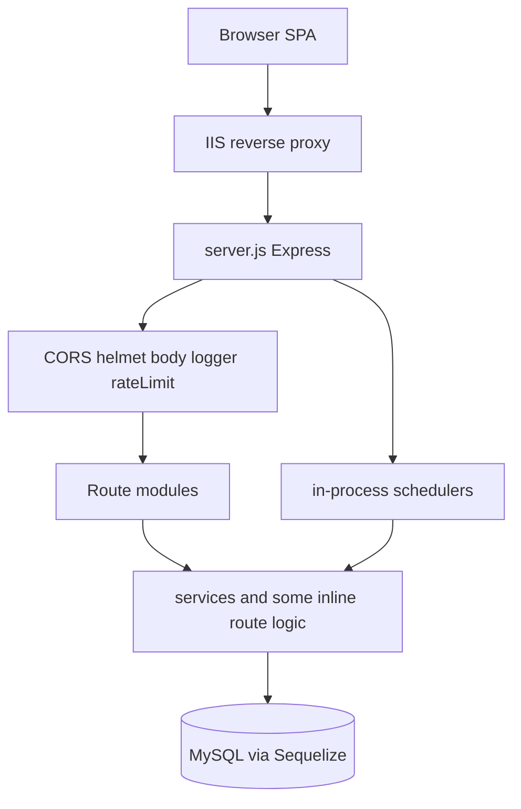
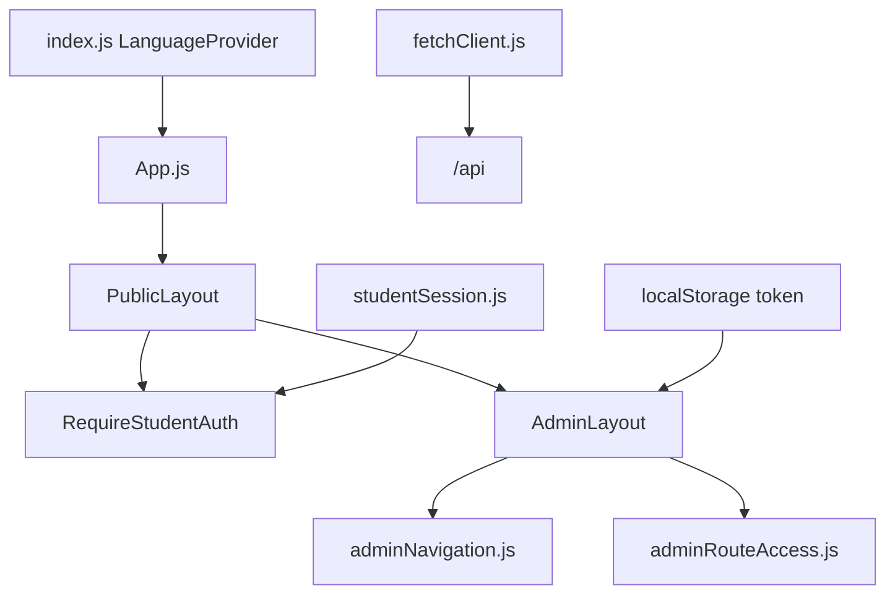
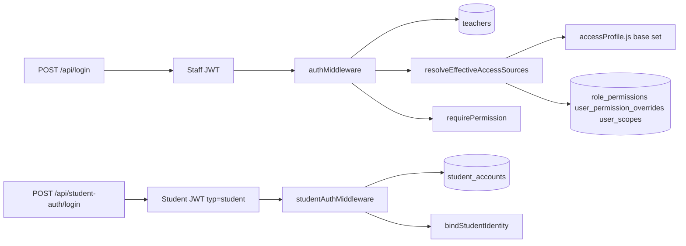
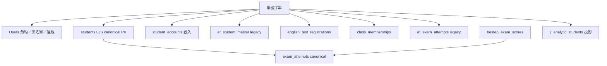

# EEARS 系統架構（SYSTEM_ARCHITECTURE）

- 稽核日期：2026-10-29
- 本圖描述程式實際掛載與資料所有權，不是目標架構。
- 與盤點重複的檔案清單見 `SYSTEM_INVENTORY.md`。

## 執行形態

瀏覽器載入 Vite 建置的 SPA。開發時前端 port 3001 把 `/api` 代理到後端 3000。正式環境由 `server.js` 提供 `build/`，IIS 反代到 `127.0.0.1:3000`。

同一 Node 進程同時負責：HTTP API、SPA、上傳靜態檔、學習有伴定時檢查、每日活動收斂、EWL 同步、每日備份，以及可選的口說對齊子程序。

認證沒有掛在 `/api` 全域。每個路由自己決定公開、staff JWT 或 student JWT。

## 前端組裝

狀態沒有 Redux。Staff 用 `localStorage` 的 `token`、`userRole` 等；學生用另一組鍵（`utils/studentSession.js`）。`fetchClient` 不會自動附上任一種 token，呼叫端自己組 `Authorization`。

管理端一個新頁面通常要同時改三處：`App.js`、`constants/adminNavigation.js`、`constants/adminRouteAccess.js`。`AdminLayout` 用 `getAdminRouteDeniedReason` 做 UI 擋路；後端仍須各自 `requirePermission`。

## 後端分層（實際，不是規範）

規範（`.cursor/rules/backend-api.mdc`）希望 route 薄、邏輯在 service、錯誤走 `createAPIError`。實際有三種並存：

| 形態 | 例子 |
|------|------|
| route → controller → service | `learningAnalyticsRouter` → `learningAnalyticsController` → `services/learningAnalytics/` |
| route → controller | `learningJourneyV3Router`、`importRunHistoryRouter`、`bestepRouter` |
| route 內大量 SQL／交易 | `englishTestRegistrationRouter`（3624 行）、`eventRouter`（1728 行）、`reservationRouter` 的建立預約 |

`reservationService.js` 主要涵蓋取消。建立預約的 transaction 寫在 `reservationRouter.js` 的 `POST /reservations`。

## 路由掛載（依前綴）

完整表以 `server.js` 為準。分組如下。

**公開或混合（同一 router 內同時有公開與受保護端點）**

- `/api`：`healthRouter`、`loginRouter`、`eventTypeRouter`、`eventRouter`、`reservationRouter`、`settings` 以外的 `notificationsRouter`、`teacherRoutes`、`adminRouter`、`englishTestRegistrationRouter`、`englishLearningPassportRouter`、`learningPartnerRouter`、`learningTraceRouter`、`speakingDiagnosticRouter`、`speakingCheckRouter`、`studentProgressRouter`、`classCreditAllocationRouter`、`analyticsRouter`、`reportsRouter`、`pageContentRouter`、`studentsRouter`
- `/api/survey`：`englishTableSurveyRouter`
- `/api/surveys`：`surveyRouter` 與 `surveyGatewayRouter`（gateway 的填寫／my-status **沒有** staff JWT）
- `/api/announcements`、`/api/weekly`、`/api/site-content`：公開讀取

**學生 JWT**（`studentAuthMiddleware`，`typ === 'student'`）

- `/api/student-auth` 的 `/me`、改密碼
- `POST /api/reservations`、我的預約、公開取消（仍保留取消驗證碼檢查）
- 學生進度、課堂加分配置的主讀取
- 培力報名的部分路由

**Staff JWT**（`Authorization: Bearer`，且拒絕 student token）

- 幾乎所有 `/api/admin/*`
- 例外掛法：`/api/admin/surveys` 在 `server.js` 對**同一個** `surveyRouter` 再包一層 `authMiddleware` + `CAN_VIEW_SURVEYS`
- 管理端英語學習護照 router 使用 `router.use(authMiddleware)`

**明確未掛載**

- `englishTestTrackingRouter`、`featureFlagsRouter`、`surveySettingsRouter`、`englishTestsRouter`

`server.js` 約第 145–149 行註解寫 legacy 英檢追蹤「do not mount them」，下一行仍掛 `learningJourneyRouter` 到 `/api/admin/learning-journey` 與 `/api/v3/learning-journey`，並另掛 `learningJourneyV3Router`。註解與緊鄰掛載容易讀成矛盾。`learningJourneyRouter` 是否仍被前端呼叫，本次**未**全庫追完，不能直接下線。

## 認證與授權資料流

角色（`auth/accessProfile.js`）：`admin`、`teacher`、`worker`、`office_staff`、`leader`。另有 `teacherLevel`、`staffLevel`、`workerLevel`。`admin` 取得 `permissions.js` 的全部鍵。權限同時存在程式映射與資料表；`services/accessControl/writeService.js` 有 `phase3_dual_write`。

學生個人預約以 session 學號為準：`bindStudentIdentity` 覆寫 body／query 的學號。這與業務底線一致。英語學習護照與部分學習歷程查詢**不**走這條 JWT，見領域矩陣。

## 資料所有權（高階）

同一位學生在庫裡不是單一列。

學期也不是單一型別：

| 表示 | 位置 | 鍵 |
|------|------|----|
| `semesters` | 問卷規則等 | INT `id` + `code` |
| `et_semesters` | legacy 英檢 | STRING 主鍵，如 `114-1` |
| 各表字串欄 | 報名、班級、BESTEP、`StudentSemesterProfile.semesterId` | `114-1` 這類字串 |
| `Event.semesterId` | 活動 | INT，可空；`models/index.js` **沒有** `Event.belongsTo(Semester)` |

LJS 寫入從某學期起改走 canonical（`canonicalSemesterPolicyService.js`，預設門檻 `LEARNING_JOURNEY_CANONICAL_REQUIRED_FROM_SEMESTER`，程式預設 `115-1`）。更早學期仍允許 legacy 寫入。讀取預設 v3（`learningJourneyFeatureFlags.js`），環境變數明確 `false` 才回退。

## 錯誤回應（沒有單一契約）

| 來源 | 形狀 |
|------|------|
| `errorHandler` | `error`、`errorEn`、`message`、`requestId`、`timestamp`、`path`、`method` |
| `requirePermission` 403 | 同上再加 `code: INSUFFICIENT_PERMISSIONS`、`success: false` |
| `authMiddleware` 401 | `createAPIError` 結果，通常**沒有** `success` |
| `checkSurvey` 409 | `error`、`code`、`redirectUrl`、`surveyId` |
| 預約建立 400 | `success: false`、`errorCode`、`message`、`error` |
| 部分路由 | 只回 `{ error: '...' }` |
| 較新 API | `{ success, data, requestId }`／`{ success: false, code }` |
| `ACCESS_PROFILE_STALE` | `code`、`actionHint`、`latestAccessVersion` |

前端必須同時認識 `error`、`message`、`code`、`errorCode`、`redirectUrl`。

## 依賴方向（允許與現況）

預期方向：`routes` → `controllers`／`services` → `models`。現況允許 route 直接用 Sequelize（黑名單、活動、培力報名）。`models/BlackListRecord.js` 與 `models/EventViolation.js` 在模型檔內宣告 `User` 關聯，其餘關聯集中在 `models/index.js`。

循環依賴未做全庫靜態分析，**UNVERIFIED**。已知的結構性耦合是：問卷提交同時寫 legacy 作答表與 `survey_responses`；BESTEP 分數再同步進 `exam_attempts`；權限 JSON 與資料表雙寫。

## 與本圖故意分開的東西

- Import Center 只是後台導覽（`importCenterCards.js`）。上傳仍在各功能頁。
- 微學習題庫由 `reservation-frontend` 的 `vocab:*` 腳本產生，執行在瀏覽器，不進 MySQL 主檔。
- 旅次分帳（`tripCountRouter`）是後台附屬功能，與英語教學域無共用學生主檔。
